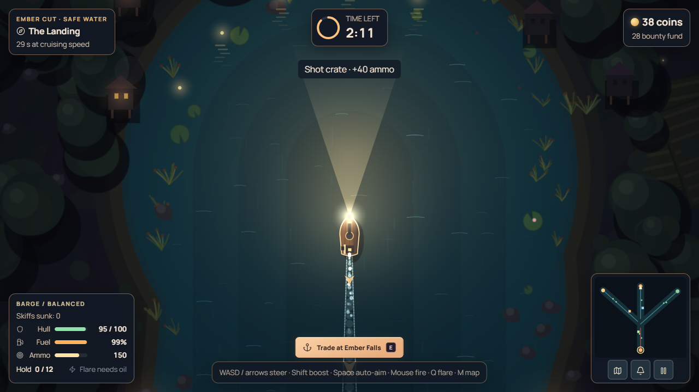
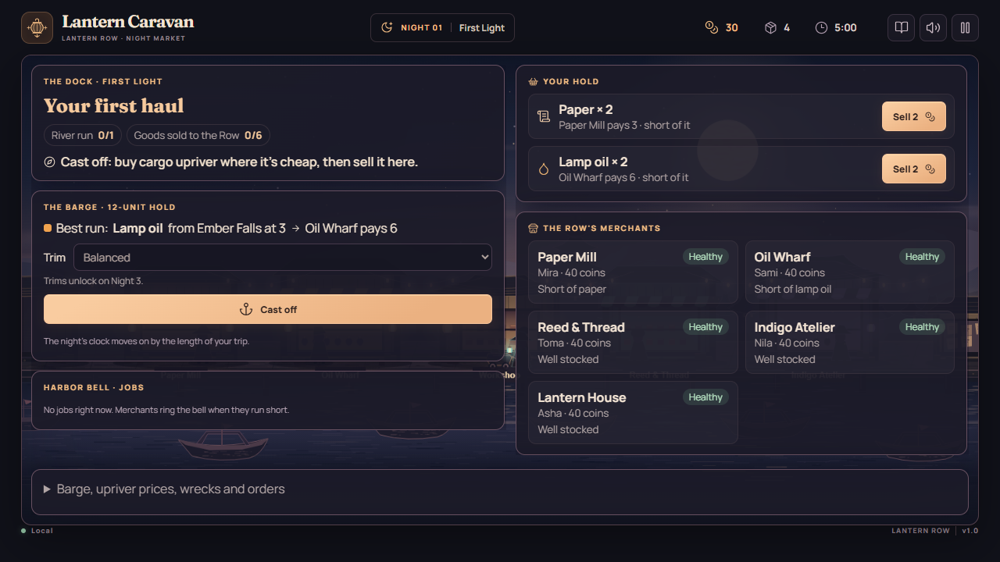
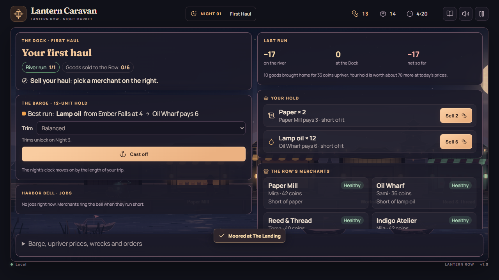
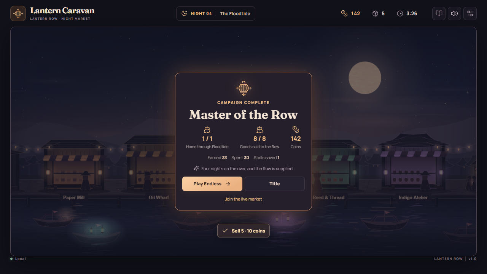

# Lantern Caravan

A river trading game. Run a barge upriver, buy cargo where it's cheap, fight off pirates, and sell it to the merchants of **Lantern Row**, a night market where every merchant is an AI-run business with its own purse. The game is **Lantern Caravan**; the market is **Lantern Row**.



**Play it now: [lanterncaravan.duckdns.org](https://lanterncaravan.duckdns.org).** **Start** plays the four-night campaign in your browser. **Live market → Join The Row** puts you in the shared public market, which settles on NEAR testnet. **Watch** and **History** need no sign-in.

## Check it in 5 minutes

Each step says what to do and what you should see. Steps 1 to 5 use the hosted demo; nothing needs a wallet.

1. **Open [lanterncaravan.duckdns.org](https://lanterncaravan.duckdns.org).** You see the Row at night. The footer reads **The Row settles on NEAR testnet · N transactions** and links to the latest one.
2. **Press Watch.** You see the live public Row, which runs around the clock. Click a stall's name in the bar along the bottom: you see its prices, stock and **Ownership** tab. The **Upriver** strip shows each reach's danger, booms, village cash and the rival haulers on the river.
3. **Press H (or History).** You see 24-hour and 7-day charts for every stall, village and reach, and the **Chronicle** of the AI agents' decisions, such as "Pell: Hauling 4 oil from Ember Falls to Oil Wharf."
4. **Live market → type a display name → Sign in with Google or email → Join The Row.** Privy creates your own NEAR testnet account in the background (no wallet, no seed phrase), and **Your NEAR account** links to it. Plain **Sign in** plays as a guest instead. You arrive at the Dock with a small starting hold. Press a **Sell** button. You see "Confirming…", then **Trade confirmed** with a **Settled on NEAR** link to that sale's transaction: one `game_settle` call with two NEP-245 `mt_transfer` events, your goods to the merchant's own account (for example `mira.lantern-caravan.testnet`) and coins back to your account.
5. **Press J (Journal).** Every confirmed action is listed with a **Details** link to its transaction.
6. **Read a balance from the chain** (NEAR CLI): `near view items.lantern-caravan.testnet mt_balance_of '{"account_id":"mira.lantern-caravan.testnet","token_id":"coin"}'`. You see the Paper Mill merchant's coin balance on chain. Agents' own trades settle before every player action and otherwise about once an hour, so between those it can trail the game by a few coins.
7. **Run it locally** with no keys: `npm ci && npm run dev`, then **Start** for the four-night campaign. `npm test` passes, and `npm run simulate -- --nights 200 --seed 42 --check` prints the economy summary in a few seconds.

## Play

Use Node.js 24.

```sh
npm ci
npm run dev
```

Open the URL Vite prints and press **Start**. You arrive at **the Dock**: tonight's goal, a hint for the next step, one **Cast off** button, the Harbor Bell's jobs, your hold, and the Row's merchants. The loop is simple:

1. **Cast off.** The Dock suggests the best run: which village sells a good cheap and which merchant is short of it.
2. **Upriver**, buy cargo at a village, fight off pirates, and race the clock home.
3. **Sell your haul** from the Dock. A merchant short of a good pays you its full asking price, up to three times the base price when it's scarce. Click a merchant's card for the full trade panel and shares.

The campaign is four river nights:

| Night | Goal |
| --- | --- |
| 1 · First Haul | **Your first haul**: one run and six goods sold to the Row. |
| 2 · The Dark Wharf | **Relight the wharf**: accept the Harbor Bell's relief job and haul oil from Ember Falls. |
| 3 · Pirates on the Reach | **Clear the reach**: break the Marsh Bend boom and deliver a contract. |
| 4 · The Floodtide | **Ride the Floodtide**: get home through both lock gates when the river rises, and sell eight goods. |

Endless nights and live rooms ask you to **keep the Row supplied**: two runs and twelve goods sold. A local save is automatic. **J** opens the journal, **H** the market history, and **Esc** pauses.

On the river, **WASD** or **arrows** steer, **Shift** boosts, **Space** fires at the nearest threat, and the **mouse** aims and fires manually. **E** trades, moors, salvages a wreck or visits a riverside stop, **Q** spends one oil on a flare, **M** opens the map, **J** opens the Harbor Bell, and **Esc** pauses outside shared rooms. On touchscreens, use the steering stick and the fire, boost and flare buttons. Each run has a 2:30 timer, shorter when you leave late in the night. Leaving during the night costs night time; shared rooms keep trading while you're away.

The **Harbor Bell** lists supply contracts, escorts and relief hauls: guaranteed pay for a delivery. Choose Balanced, Runner, Ironclad or Gunner **trim** on the Dock before you cast off; trims unlock on campaign Night 3 and are always available in Endless and live rooms.

The Dock's drawer (**Barge, upriver prices, wrecks and orders**) holds the rest:

- **Barge upgrades and finishes.** Upgrades add deck crates, iron bands and plating, larger cannons and twin barrels, extra stacks and a stern paddle wheel. Paint, bow lantern and prow figure change appearance only; paid finishes fund harbor relief.
- **Upriver prices** at each village, with the trusted-hauler discount once you've earned it.
- **The harbor almanac**, which warns of village events a night ahead: an oil glut or a pressing strike at Ember Falls, a mill flood at Millbrook, a dye bloom or reed blight at Reedmarsh. Merchants read it too and restock early.
- **Wrecks.** Hauls that pirates sink keep their cargo in the water and open for salvage at the next dusk, for two nights.
- **Bell orders** (live rooms and Endless): name a village good, how many and what you'll pay. Your coins wait at the bell, and rival haulers, each with their own purse, decide whether the job is worth the trip.

Gold **skiffs** ram your barge and spill cargo: recover it within 20 seconds. Coral **raiders** patrol at medium range; purple **gunboats** fire twin shots from farther away. Bounties are 6, 8 and 14 coins, while the harbor fund lasts. Two or three optional **riverside stops** appear on each run (a stranded fisher, a lock keeper's shed, an overturned punt), each offering one choice of hull, fuel or ammo.

On festival nights the river rises in a **Floodtide**. If you're upriver when it starts, you have 60 seconds to sail through both lock gates and moor at The Landing. Make it and a supply contract pays its premium twice; miss it and the village you bought from takes the cargo back at its buyback price.

| The Dock | Home with a haul | Campaign complete |
| --- | --- | --- |
|  |  |  |

## On NEAR

The public Row's economy lives on NEAR testnet. Every coin, good and stall share is a token on one NEP-245 multi-token contract, [`items.lantern-caravan.testnet`](https://testnet.nearblocks.io/address/items.lantern-caravan.testnet) (source in [`contracts/items/`](contracts/items/)).

- **Players.** Each confirmed action in the public Row (a sale at the Dock, a purchase, a haul settled at the Landing) is its own `game_settle` transaction, keyed by the action's id so a retry can't settle twice. The game shows **Settled on NEAR** with a link to the transaction, and the Journal keeps a link for every action.
- **AI merchants, rival haulers and villages** are registered agent accounts with their own balances. Their trading is settled in `game_settle_batch` transactions: before every player action, and otherwise about once an hour.
- **Conservation.** Goods enter the economy only through village harvests and leave only when they're used up; every trade is a transfer between holders. `npm run near:verify -- --data <data folder>` reads every holder's balance from the contract and checks it against the live Row.
- **Social login.** **Sign in with Google or email** uses [Privy](https://privy.io): it creates the player's own NEAR testnet account (an implicit account from a Privy embedded wallet), and the server checks Privy's identity token against the app's public keys before trusting it. That account is the player's ID, so their coins, goods and shares settle to an account they own. The player never signs anything or pays gas; the game's operator settles every action.
- **What's local.** Private rooms and the offline campaign use a local ledger. Guests (display name only) settle to derived `*.players.lantern-caravan.testnet` holders, and the operator signs the agents' transfers; agent-signed transactions (NEP-366) are next.

The footer links the contract and counts settled transactions, and `GET /v1/chain/status` reports the queue and the latest transaction. [Running](docs/RUNNING.md#near-testnet-settlement) covers settlement setup and checks.

## Live market and tests

```sh
npm run dev:server
npm test
npm run build
# PowerShell: use system Chrome; no browser download needed.
$env:LANTERN_CHROME_CHANNEL = "chrome"
npm run test:e2e -- --project=chrome
npm run simulate -- --nights 2000 --seed 42 --check
```

**Live market** opens the shared public Row or a private room. **Watch** and **History** are public. The river strip shows reach danger, booms, village cash bands and who is upriver. History includes village cash, source prices and available stock, plus reach danger and booms. Deliver two supply contracts for the same village to earn its trusted-hauler stamp and 10% off future village purchases. The development server uses local providers and saves to `apps/server/data/`. See [Running](docs/RUNNING.md) for deployment and test options.

## How it was made

- **Built during the hackathon.** Development started in November 2026; the first commit is dated 5 November 2026.
- **Built with** TypeScript, Phaser, React, Vite, Zod, Vitest, Playwright, Lucide, Fontsource, Privy (social login), jose and near-sdk (Rust), with original procedural art and synthesized audio. [Asset credits](docs/ASSETS.md)
- **AI tools.** OpenAI Codex and Claude Code assisted implementation, testing and documentation. The demo video's narration was generated with Gemini TTS and its music with Lyria.
- **Testnet only.** Every token lives on NEAR testnet; nothing in the game has real-world value.

[Handoff](docs/HANDOFF.md) · [Architecture](docs/ARCHITECTURE.md) · [API](docs/API.md) · [Balance](docs/BALANCE_REPORT.md) · [Known issues](docs/KNOWN_ISSUES.md)
