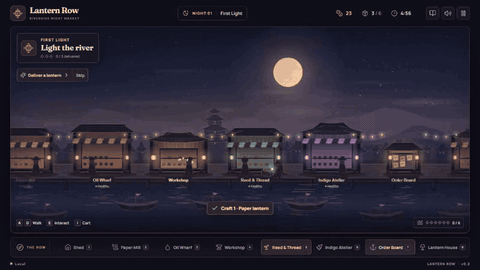
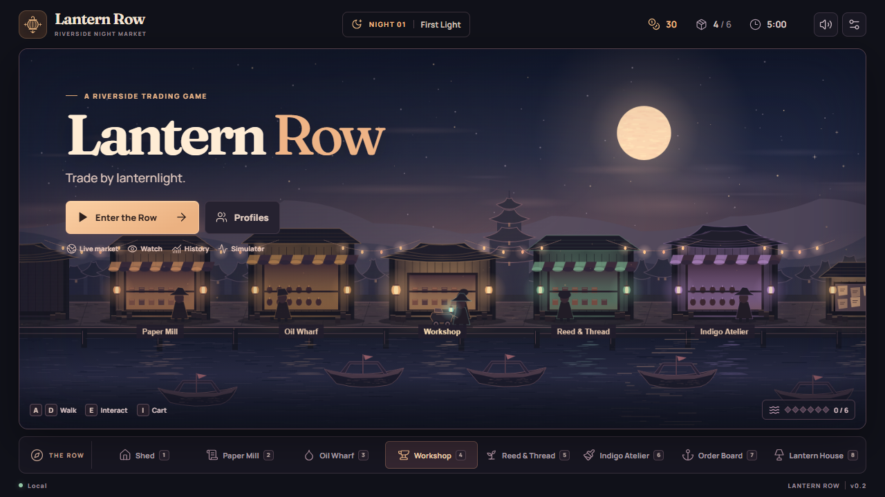
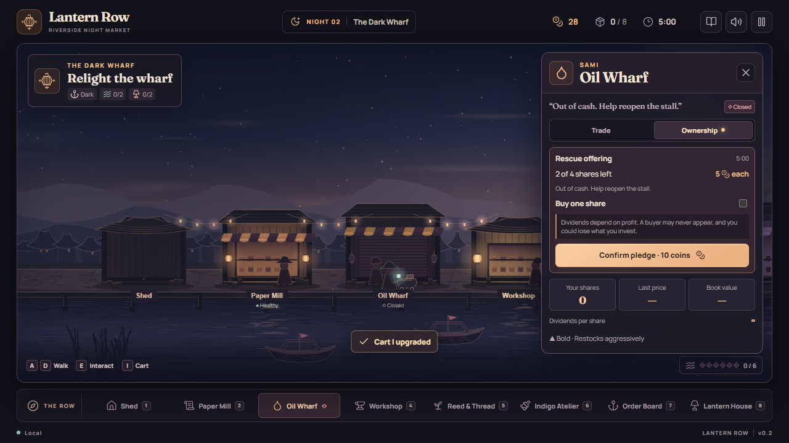

# Lantern Caravan

A night market where every merchant is an AI-run business, and you can own a piece of it. The market is **Lantern Row**; the game is **Lantern Caravan**. The planned Night 4 Floodtide procession of six festival boats is **the Lantern Caravan**.



## Play

Use Node.js 24.

```sh
npm ci
npm run dev
```

Open the URL Vite prints. In **First Light**, your cart starts with two paper and two oil. Visit the Workshop, craft lanterns, then deliver them at the Order Board. Buy more supplies and deliver three lanterns to unlock **The Dark Wharf**. Help reopen the wharf, earn dividends, and cast a strategy vote before the **Festival of Lights**. After the festival, your cart and shares carry into Endless.

Click a location or use **1–8** to walk there. **A/D** or **←/→** walks manually, **E** interacts, **I** opens the cart, **J** opens the journal, **H** opens history, and **Esc** closes or pauses. Hover an ingredient for its name or click it to find a stall. A local save is automatic.

From Night 2 onward, visit **The Landing** to cast off on a River Run, before the market opens or during the night. The **Harbor Bell** lists supply contracts, escorts and relief hauls: on The Dark Wharf, haul oil from Ember Falls to relight the wharf, or pledge shares to rescue it. Upriver, buy freely at any village, fight off pirates and armored gunboats, break toll booms, and collect floating fuel, shot and repair barrels. Moor at The Landing to settle, then sell your haul on the Row or use it at the Workshop. Leaving during the night costs night time; shared rooms keep trading while you're away.

On the river, **WASD** or **arrows** steer, **Shift** boosts, **Space** fires at the nearest threat, and the **mouse** aims and fires manually. **E** trades, moors, salvages a wreck or visits a riverside stop, **Q** spends one oil on a flare, **M** opens the map, **J** opens the Harbor Bell, and **Esc** pauses outside shared rooms. On touchscreens, use the steering stick and the fire, boost and flare buttons. Each run has a 2:30 timer, shorter when you leave late in the night.

At The Landing's **Barge** tab, choose Balanced, Runner, Ironclad or Gunner trim. Switching is free and takes effect when you cast off; the HUD names your trim. Trims unlock on campaign Night 3 and are always available in Endless and live rooms.

Gold **skiffs** ram your barge and spill cargo: recover it within 20 seconds. Coral **raiders** patrol at medium range; purple **gunboats** fire twin shots from farther away. Bounties are 6, 8 and 14 coins respectively, while the harbor fund lasts.

The **harbor almanac** at The Landing warns of village events a night before they happen: an oil glut or a pressing strike at Ember Falls, a mill flood at Millbrook, a dye bloom or reed blight at Reedmarsh. Merchants read it too and restock early before a shortage.

Hauls that pirates sink become **wrecks**: their cargo stays in the water and opens for salvage at the next dusk, for two nights, before the river takes it. The Landing lists every wreck. Two or three optional **riverside stops** appear on each run (a stranded fisher, a lock keeper's shed, an overturned punt), each offering one choice of hull, fuel or ammo.

| First Light | The Dark Wharf | Festival of Lights |
| --- | --- | --- |
|  |  |  |

## Live market and tests

```sh
npm run dev:server
npm test
npm run build
# PowerShell: use system Chrome; no browser download needed.
$env:LANTERN_CHROME_CHANNEL = "chrome"
npm run test:e2e -- --project=chrome
npm run simulate -- --nights 2000 --seed 42 --check
```

**Live market** opens the shared public Row or a private room. **Watch** and **History** are public. The development server uses local providers and saves to `apps/server/data/`. See [Running](docs/RUNNING.md) for deployment and test options.

Built with TypeScript, Phaser, React, Vite, Zod, Vitest, Playwright, Lucide, Fontsource, and original procedural art and synthesized audio. OpenAI Codex assisted implementation and verification. [Asset credits](docs/ASSETS.md)

[Handoff](docs/HANDOFF.md) · [Architecture](docs/ARCHITECTURE.md) · [API](docs/API.md) · [Balance](docs/BALANCE_REPORT.md) · [Known issues](docs/KNOWN_ISSUES.md)
